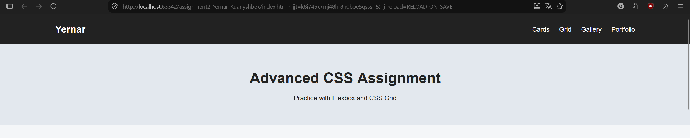
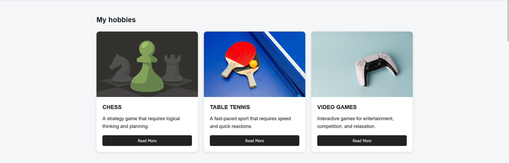
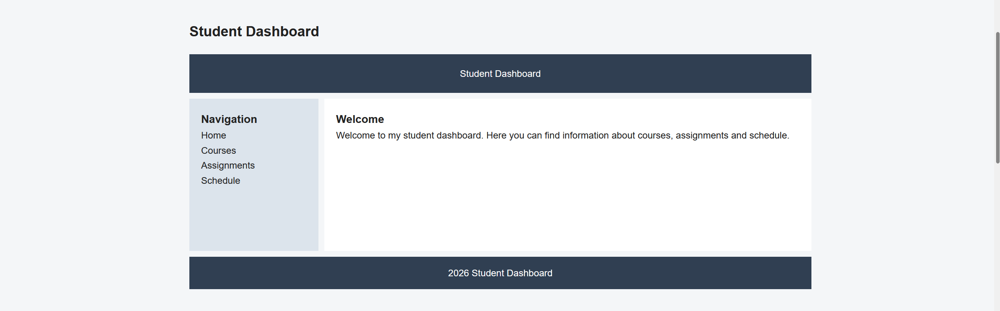
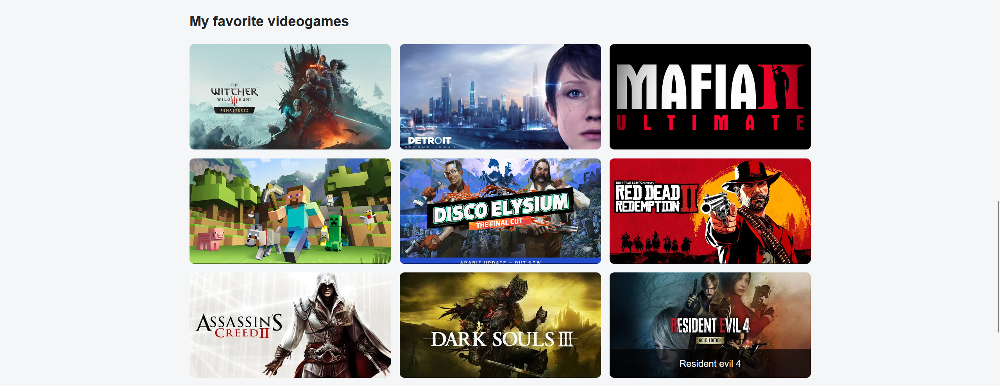
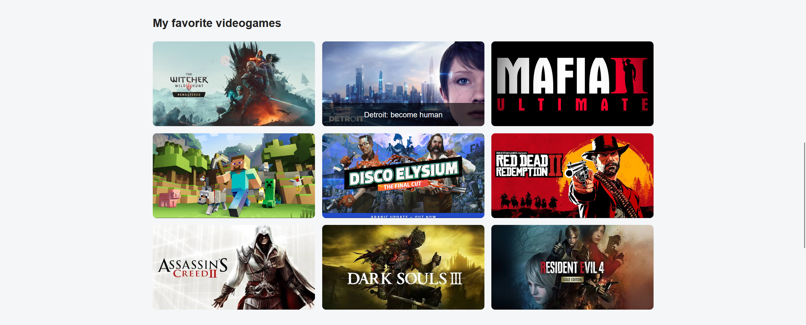
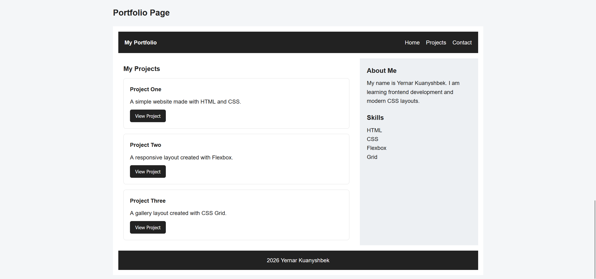

# Assignment 2 - Advanced CSS (Flexbox & Grid)

**Name:** Yernar Kuanyshbek
**Group:** SE-2539

## Objective

The purpose of this assignment is to practice modern CSS layout techniques using Flexbox and CSS Grid.

## Task 0 - Navigation Bar

I created a header with a logo on the left and navigation links on the right. I used Flexbox to place the elements horizontally, add spacing, and vertically center them.

**Screenshot:**

## Task 1 - Card Row

I created three cards. Each card contains a visual area, title, description, and button. Flexbox is used to display the cards in one row with equal height and consistent gaps. I also added a hover effect.

**Screenshot:**

## Task 2 - Page Layout with Grid Areas

I created a layout with a header, sidebar, main content, and footer. CSS Grid and grid-template-areas are used to control the position of each section.

**Screenshot:**

## Task 3 - Image Gallery

I created a gallery with nine visual items. CSS Grid creates three equal columns with consistent gaps. A caption appears when the user hovers over an item.

**Screenshot:**

**Hover effect:**

## Task 4 - Portfolio Page

I created a simple portfolio layout that combines Flexbox and CSS Grid. The header navigation uses Flexbox. The main portfolio layout uses Grid for the projects area and sidebar. Flexbox is also used inside each project card.

**Screenshot:**

## Summary

In this assignment, I practiced Flexbox and CSS Grid. I used Flexbox for navigation, cards, alignment, and spacing. I used CSS Grid for page layouts, the gallery, and the portfolio structure. I also added hover effects and a responsive layout for smaller screens.
